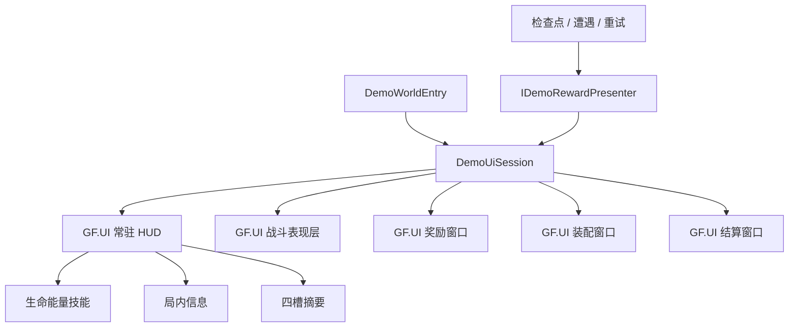

# Demo UI组合与生命周期

## 职责

2026-10-07用户三轮确认：代码与预制体一起拆分，玩法/操作保持；弹窗使用GF.UI按需加载，常驻HUD按功能区拆分。决策检查点见Docs/GameDesign/90-设计管理/2026-10-07-HUD拆分决策检查点.md。

| 类型 | 资源 | 责任 |
|---|---|---|
| DemoHudForm + DemoHudController | Prefabs/UI/DemoHud | 三个显示区的组合、绑定和解绑 |
| DemoVitalsView | UI/Item/DemoHudVitals | 生命条、生命/能量、技能冷却与复活状态 |
| DemoRunInfoView | UI/Item/DemoHudRunInfo | 货币、操作提示、检查点增益及奖励通知 |
| DemoLoadoutView | UI/Item/DemoHudMarkSummary | 四槽图标/空态，发布装配按钮意图 |
| DemoCombatOverlayForm | UI/DemoCombatOverlay | 伤害飘字与敌人状态显示层 |
| DemoRewardForm + DemoRewardChoiceView | UI/DemoRewardChoice | 奖励卡、悬停、二次点击确认和结果通知 |
| DemoMarkAssemblyForm + DemoMarkAssemblyView | UI/DemoMarkAssembly | 已拥有列表、槽位选择和装卸操作 |
| DemoCompletionForm + DemoCompletionView | UI/DemoCompletion | 完成提示、重试及关闭 |
| DemoUiSession | 会话组件，无UI资源 | 语义输入、互斥、请求及退出清理；持有奖励模型 |
| DemoUiWindowLease | 每个窗口一个请求句柄 | GF请求、取消/失败、参数池所有权及加载暂停交接 |

## 加载与暂停

- HUD与表现层完成绑定后才启用玩法；三个弹窗首次请求时加载，不在HUD Awake中创建。
- 展示配置提供五个UI资源路径及玩法配置。使用现有UGUI与GF.UI，不引入新包。
- 暂停弹窗请求立即登记一个加载暂停；成功后Form绑定GamePauseWindow，再释放加载登记。关闭、失败、取消与会话退出都释放登记。仍由Game.State决定最后请求释放后恢复原倍率。
- GF关闭窗口调用Form解绑、释放暂停与关闭回调，再回收UIParams；加载取消路径不调用Form生命周期，由请求句柄释放尚未交接的UIParams。池复用每次重新绑定。
- GF排序：表现层10、HUD20、装配30、奖励40、结算50。UI关闭快捷键由IDemoInputSource语义输入控制，窗口不直接读键盘。
- Boss完成提示等待奖励选择结束；重试取消全部弹窗并清空通知。退出时取消加载请求，关闭已打开窗口并解绑旧玩家。

## 维护

直接编辑各独立Prefab，使用显式序列化控件引用。显示组件不创建弹窗、判断互斥或读取输入；窗口View不通过HUD根节点查找其他模块。

迁移菜单Shanhai/Demo/Split UI composition完成后再次运行不覆盖已编辑资源。旧Author mark assembly整体生成器会拒绝拆分后的HUD，避免写回旧结构；悬停修复工具转向独立奖励Prefab；飘字和敌人状态生成工具维护独立表现层。资源构建规则继续扫描原有UI目录。

原QA灰盒探针包含旧HUD路径、旧直接装备规则，仅作为历史证据；本批以Assets/Tests/Runtime中的自动测试为验收入口。旧Player没有本批变更，须重新构建后由用户实机验收。
